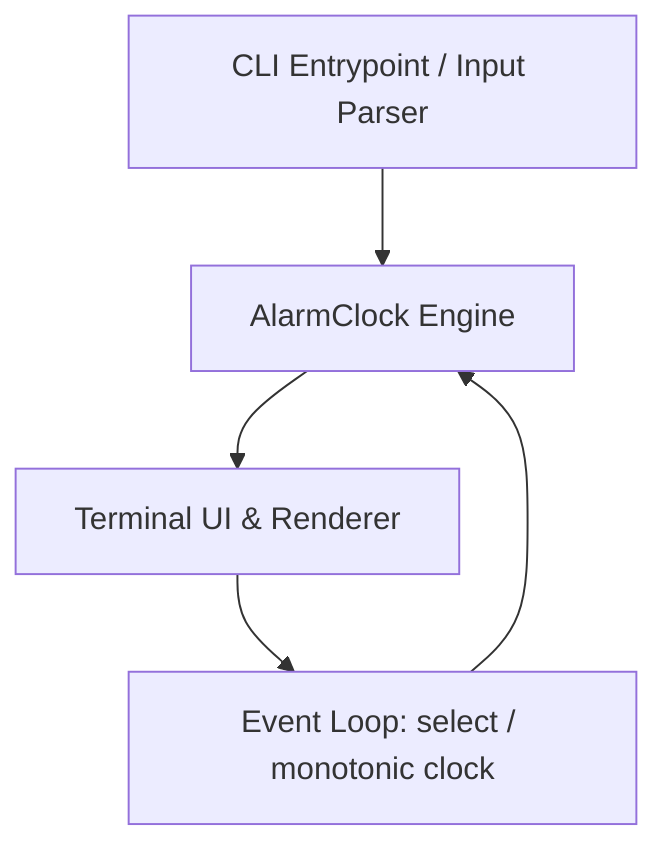
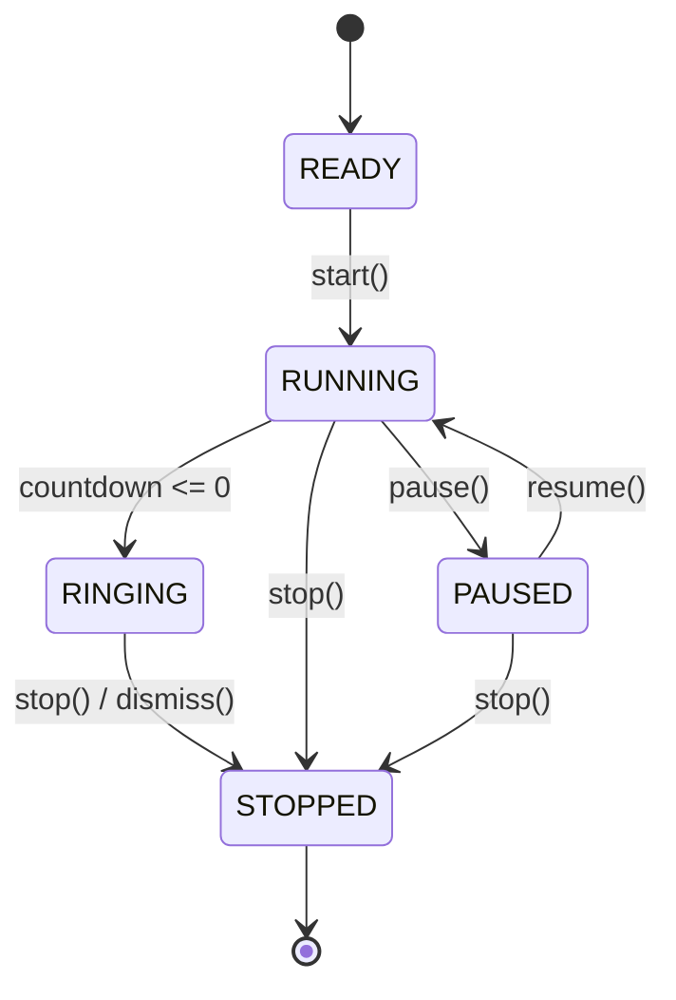

# System Design: CLI Alarm Clock

## 1. Architectural Overview

The CLI Alarm Clock is designed as a **single-threaded, non-blocking event loop** application relying solely on the Python 3 standard library (`time`, `select`, `termios`, `tty`, `sys`).

A single-threaded event loop approach is selected over multi-threading to eliminate race conditions, synchronization locks, and thread lifecycle complexity, perfectly fitting the 30-minute MVP requirement while remaining robust and testable.



---

## 2. Component Breakdown

### 2.1. Time & Duration Parser (`parse_target_seconds`)
- **Input**: User-provided string (e.g., `30s`, `5m`, `1h15m`, `14:30`, `14:30:00`, or raw seconds `120`).
- **Output**: Positive integer representing total duration in seconds.
- **Rules**:
  - Duration formats: Supports suffixes `s` (seconds), `m` (minutes), `h` (hours).
  - Target time format (`HH:MM` / `HH:MM:SS`): Compares with current wall-clock time (`datetime.now()`). If the target time has already passed today, it calculates the remaining time until that hour tomorrow (or flags an error based on configuration).
  - Validation: Raises a clean `ValueError` with guidance on invalid inputs.

### 2.2. Alarm Engine & State Machine (`AlarmEngine`)
Maintains core timing state, completely independent from terminal rendering:



- **State Variables**:
  - `state`: Enum (`READY`, `RUNNING`, `PAUSED`, `RINGING`, `STOPPED`).
  - `total_seconds`: Initial countdown duration.
  - `remaining_seconds`: Remaining seconds count.
  - `last_tick`: `time.monotonic()` timestamp used to compute precise elapsed intervals without drift.
- **Key Methods**:
  - `tick()`: Advances time using monotonic clock delta if `RUNNING`. Transitions to `RINGING` when `remaining_seconds <= 0`.
  - `pause()`: Freezes remaining seconds, changes state to `PAUSED`.
  - `resume()`: Restores ticking with a reset `last_tick` baseline, changes state to `RUNNING`.
  - `stop()`: Halts ticking, transitions to `STOPPED`.

### 2.3. Terminal I/O & Controller (`TerminalController`)
- **Non-blocking Input**:
  - Puts `sys.stdin` into **cbreak** mode using `tty.setcbreak(fd)`.
  - Uses `select.select([sys.stdin], [], [], timeout)` with a 0.1-second slice to listen for instant keypresses without requiring Enter.
  - Supported keys:
    - `Space` or `p`: Toggle Pause / Resume.
    - `s` or `q`: Stop / Quit.
- **In-place Screen Rendering**:
  - Uses carriage return `\r` and ANSI clear-line `\033[K` to render live updates cleanly on a single line:
    ```
    [RUNNING] Remaining: 00:02:45 | [Space] Pause  [s] Stop
    ```
  - When in `RINGING` state:
    - Emits audible bell (`\a`).
    - Flashes a high-visibility message:
      ```
      🔔 *** ALARM RINGING! *** Press [s] or [Enter] to dismiss 🔔
      ```
- **Terminal State Management**:
  - Saves original terminal attributes on startup via `termios.tcgetattr(sys.stdin)`.
  - Guarantees restoration via `try...finally` block and `atexit` handler, ensuring terminal settings are restored even if unexpected errors or `SIGINT` (Ctrl+C) occur.

---

## 3. Execution Flow

1. **Initialization**:
   - Parse command line args (`python main.py 10s` or prompt interactive input if omitted).
   - Instantiate `AlarmEngine(seconds)`.
   - Configure terminal cbreak mode.
2. **Main Loop (10 Hz polling cadence)**:
   - Calculate sleep / select timeout (max 0.1s).
   - Poll `sys.stdin` with `select.select`:
     - If key pressed: dispatch to `engine.pause()`, `engine.resume()`, or `engine.stop()`.
   - Call `engine.tick()`.
   - Render current state & time remaining.
   - If `state == STOPPED`, exit loop.
3. **Shutdown**:
   - Restore terminal settings.
   - Print final status summary.

---

## 4. Key Design Decisions & Tradeoffs

| Decision | Alternative Considered | Rationale |
| :--- | :--- | :--- |
| **Single-threaded Event Loop (`select`)** | Multi-threaded (`threading.Thread`) | Eliminates race conditions, locks, and complex thread teardown. 0.1s polling yields instant interactive response. |
| **Monotonic Clock (`time.monotonic`)** | Wall clock (`time.time`) | Monotonic clock is immune to system time changes, leap seconds, and NTP adjustments. |
| **Standard Library Only (`termios`, `select`)** | `curses` or `prompt_toolkit` | `curses` is heavy, takes over the full screen, and complicates simple CLI pipe usage. Zero external pip packages ensures instant execution. |
| **Decoupled Engine** | Monolithic script | Enables unit testing of the countdown and state machine without mocking terminal I/O. |
